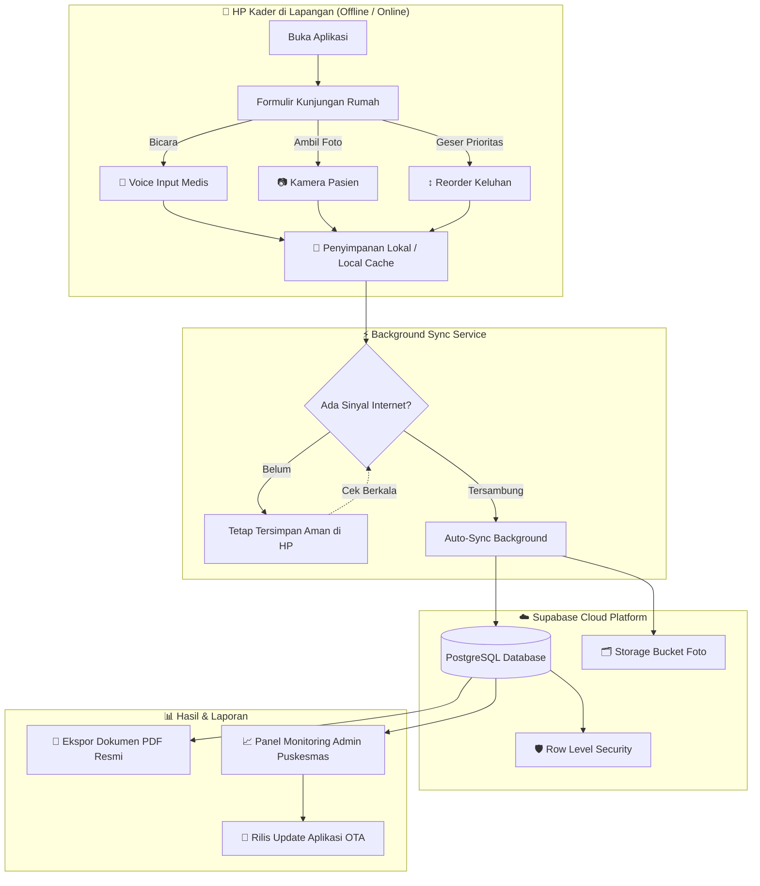

<div align="center">

# 🏥 Laporan Kunjungan Rumah Puskesmas
### *Mendukung Kader & Tenaga Kesehatan Menjangkau Setiap Warga hingga ke Pelosok*

<br>

[](#-riwayat-pembaruan)
[](https://flutter.dev/)
[](#-arsitektur-offline-first)
[](https://supabase.com/)
[](#)

<br>

<p align="center">
  <b>Aplikasi pencatatan kunjungan rumah (home visit) terpadu yang dirancang khusus untuk kenyamanan Ibu-Ibu Kader Posyandu dan Petugas Medis Puskesmas. Bebas dipakai tanpa sinyal internet, ramah pengguna, dan dilengkapi asisten suara medis pintar.</b>
</p>

---

</div>

<br>

## 💡 Mengapa Aplikasi Ini Dibuat? (Latar Belakang & Tujuan)

Di lapangan, **Kader Kesehatan Posyandu dan Petugas Puskesmas** adalah garda terdepan pelayanan kesehatan masyarakat. Mereka menyusuri gang, mengetuk pintu warga lansia, balita stunting, ibu hamil berisiko tinggi, serta pasien penyakit kronis di berbagai pelosok desa.

Namun, selama ini mereka menghadapi kendala nyata:
1. **Tumpukan Kertas & Buku Tebal:** Pencatatan manual rentan tercecer, mudah sobek, basah terkena hujan di jalan, atau rusak termakan waktu.
2. **Ketiadaan Sinyal di Rumah Pasien (*Blank Spot*):** Banyak wilayah pelosok dan gang sempit yang tidak memiliki akses internet stabil saat pemeriksaan berlangsung.
3. **Kerumitan Mengetik di Layar HP:** Ibu-ibu kader sering kali merasa lelah dan kesulitan jika harus mengetik nama obat, tensi darah, atau catatan keluhan panjang di keyboard sentuh yang kecil.
4. **Beban Rekap Administrasi Bulanan:** Petugas kesehatan harus menghabiskan berhari-hari hanya untuk memindahkan catatan kertas ke komputer demi membuat laporan dinas bulanan.

> **Misi Utama Aplikasi Ini:**  
> Memberikan alat kerja digital yang **paling sederhana, ramah ibu-ibu, tidak pernah macet saat mati sinyal**, serta otomatis menyusun laporan medis rapi dalam sekejap — sehingga kader dan nakes dapat lebih berfokus pada kesehatan pasien, bukan pada rumitnya administrasi.

<br>

---

## 🌟 Sorotan Fitur Unggulan

<table>
<tr>
<td width="50%" valign="top">

### 🎤 Asisten Suara Pintar (Voice Input)
- **Bicara Tanpa Perlu Ngetik:** Kader cukup menekan ikon mikrofon dan mendiktekan keluhan atau data pasien.
- **Paham Format Medis Indonesia:** Otomatis mengubah ucapan *"seratus tiga puluh per delapan puluh"* menjadi **`130/80 mmHg`**, memformat desimal suhu, NIK angka, dan nama pasien.
- **Visualizer Gelombang Suara & Tombol Ulangi:** Tampilan animasi gelombang yang hidup serta tombol *"Ulangi"* sekali ketuk bila ada ucapan yang kurang pas.

</td>
<td width="50%" valign="top">

### 🌐 Arsitektur 100% Offline-First
- **Tetap Bekerja Tanpa Kuota / Sinyal:** Seluruh isian form, riwayat kunjungan, dan foto pasien langsung tersimpan aman di memori lokal HP.
- **Sinkronisasi Otomatis ke Cloud:** Begitu HP terhubung Wi-Fi atau mendapat sinyal internet, data otomatis disinkronkan ke Supabase Cloud tanpa perlu tombol manual.
- **Indikator Realtime Sejuk:** Banner status koneksi ramah yang memberi tahu status sinkronisasi tanpa membuat panik pengguna.

</td>
</tr>

<tr>
<td width="50%" valign="top">

### 📋 Formulir Pemeriksaan Tertata & Drag-and-Drop
- **Desain Kartu Bertahap:** Data pasien, tanda vital, keluhan, dan tindakan dipisah per kartu bersih agar tidak membingungkan.
- **Geser Urutan (Reorderable):** Posisi keluhan dan rencana tindak lanjut bisa digeser naik-turun dengan mudah untuk mendahulukan prioritas darurat.
- **Dokumentasi Foto Lapangan:** Lampirkan foto kondisi fisik pasien atau lingkungan rumah langsung dari kamera.

</td>
<td width="50%" valign="top">

### 📄 Ekspor PDF Resmi Sekali Ketuk
- **Format Siap Cetak:** Menghasilkan lembar laporan kunjungan rapi sesuai tata naskah dinas kesehatan.
- **Lengkap dengan Dokumentasi:** Menyertakan identitas puskesmas, tanggal periksa, tabel ringkasan pasien, tanda tangan petugas, dan lampiran foto.
- **Bagikan Instan:** Kirim langsung ke WhatsApp grup puskesmas atau simpan ke Google Drive.

</td>
</tr>

<tr>
<td width="50%" valign="top">

### 👥 Manajemen Peran & Hak Akses (Multi-Role)
- **Struktur Bertingkat:** Hierarki wewenang rapi: `Owner` › `Developer` › `Admin` › `User / Kader`.
- **Peran Kustom (Custom Roles):** Fleksibilitas menentukan hak akses bagi bidan desa, dokter penanggung jawab, maupun koordinator kader.
- **Keamanan Berlapis:** Dilengkapi perlindungan Row-Level Security (RLS) di tingkat database PostgreSQL.

</td>
<td width="50%" valign="top">

### 🚀 Pembaruan Aplikasi Otomatis (OTA Update)
- **Update Ala Play Store:** HP kader otomatis mendeteksi jika pengembang atau admin merilis pembaruan versi baru.
- **Unduh & Pasang Cepat:** Notifikasi pop-up elegan dengan catatan rilis yang mudah dipahami, progres unduhan, dan pemasangan otomatis.
- **Pembersihan Cerdas (Auto-Cleanup):** Secara berkala membersihkan berkas sementara lama agar penyimpanan HP tetap lega.

</td>
</tr>
</table>

<br>

---

## 🎨 Desain yang Memanusiakan Pengguna (*Human-Centered Design*)

Aplikasi ini didesain dari nol dengan memperhatikan kebutuhan fisik dan psikologis ibu-ibu kader di lapangan:
- **Ukuran Sentuh Luas (Minimal 44×44 px):** Mencegah salah tekan tombol saat kader berjalan atau terburu-buru.
- **Warna Sejuk Ramah Mata (*Healthcare Palette*):** Dominasi biru laut lembut (`#0A64A8`), toska segar (`#176B40`), dan putih bersih yang tidak menyilaukan saat digunakan di bawah terik matahari.
- **Tipografi Jelas & Terbaca:** Ukuran font proporsional, kontras tinggi, dan istilah teknis diganti dengan bahasa sehari-hari yang santun dan akrab.

<br>

---

## 🏗️ Alur Kerja Sistem & Arsitektur



<br>

---

## 📂 Struktur Direktori Proyek

```text
lib/
├── main.dart                          # Inisialisasi aplikasi, tema & Supabase
├── models/                            # Struktur data aplikasi
│   ├── report.dart                    # Model laporan kunjungan
│   ├── resident_exam.dart             # Model data pemeriksaan pasien
│   ├── user_session.dart              # Model sesi pengguna aktif
│   └── custom_role.dart               # Model peran & perizinan
├── screens/                           # Tampilan antarmuka layar
│   ├── splash_screen.dart             # Layar pembuka aplikasi
│   ├── login_screen.dart              # Layar masuk (Email & Google Sign-In)
│   ├── dashboard_screen.dart          # Menu utama, status offline & statistik
│   ├── report_form_screen.dart        # Form utama laporan kunjungan
│   ├── resident_exam_form_screen.dart # Form pemeriksaan lengkap pasien
│   ├── report_history_screen.dart     # Riwayat laporan & pencarian
│   ├── success_screen.dart            # Konfirmasi sukses simpan/kirim
│   ├── admin_panel_screen.dart        # Panel kontrol admin, user, & storage
│   └── custom_roles_screen.dart       # Manajemen peran kustom
├── services/                          # Logika bisnis & komunikasi data
│   ├── storage_service.dart           # Engine offline-first & cache lokal
│   ├── supabase_service.dart          # Cloud database, storage, & auth
│   ├── speech_service.dart            # Pengenal suara mikrofon
│   ├── voice_text_cleaner.dart        # Pembersih teks suara & konversi medis
│   └── update_service.dart            # Otomasi pengecekan & unduh update OTA
└── widgets/                           # Komponen UI bersama
    ├── changelog_dialog.dart          # Pop-up "Apa yang baru" (Changelog)
    ├── update_dialog.dart             # Dialog instalasi update OTA
    ├── connectivity_banner.dart       # Indikator koneksi internet
    └── ui/                            # Design system (tombol, kartu, ikon, input)
```

<br>

---

## 🚀 Panduan Memulai (Developer Setup)

### 1. Prasyarat Sistem
- **Flutter SDK:** Versi `3.8.0` ke atas (Direkomendasikan channel `stable`)
- **Android SDK:** Minimum API Level 21 (Android 5.0 Lollipop) atau lebih baru
- **Editor:** Visual Studio Code atau Android Studio

### 2. Instalasi & Menjalankan Aplikasi
```bash
# Clone repositori
git clone https://github.com/ESTAS-crypto/android-puskesmas.git

# Masuk ke direktori
cd android-puskesmas

# Ambil seluruh dependencies
flutter pub get

# Jalankan di perangkat Android fisik / emulator
flutter run
```

### 3. Build & Rilis APK Cepat
Proyek ini dilengkapi dengan skrip otomatis [`build_app.py`](file:///c:/dev/laporan_kunjungan/build_app.py) yang melakukan build release, membaca catatan rilis dari [`release_notes.txt`](file:///c:/dev/laporan_kunjungan/release_notes.txt), dan langsung meng-upload APK ke server update Supabase:

```bash
# Jalankan Build Wizard terintegrasi
python build_app.py
```

<br>

---

## 🗄️ Skema Database & Keamanan (Supabase Cloud)

Arsitektur database mengedepankan integritas data medis dan privasi warga:
- **`profiles`**: Identitas petugas, email, nama puskesmas, dan role pengguna.
- **`reports`**: Induk laporan kunjungan per wilayah, bulan, dan tahun.
- **`resident_exams`**: Rincian pemeriksaan setiap pasien (NIK, alamat, keluhan, tensi/vital sign, tindak lanjut, dan berkas foto).
- **`custom_roles`**: Pengaturan hak akses granular untuk fleksibilitas institusi.
- **`app_config`**: Konfigurasi jarak jauh (Remote Config), kebijakan auto-cleanup, dan metadata update OTA.
- **Row-Level Security (RLS):** Petugas hanya dapat mengakses dan mengelola laporan sesuai hak puskesmas atau wilayah tugasnya.

<br>

---

## 📋 Catatan Rilis & Riwayat Versi

### Versi 2.8.0 (Terbaru)
- **Baru:** Wajah baru seluruh antarmuka (Beranda, Formulir, Riwayat) yang lebih bersih, tombol luas, dan ramah ibu-ibu.
- **Baru:** Asisten suara cerdas dengan kemampuan membaca tensi darah, nama, NIK, dan alamat pasien.
- **Baru:** Fitur geser urutan (*drag & drop*) pada keluhan dan rencana tindak lanjut pasien.
- **Peningkatan:** Alur isian pemeriksaan per kartu bertahap untuk mencegah kelelahan kader saat mengisi data.
- **Peningkatan:** Ketahanan sistem offline saat tidak ada sinyal internet.
- **Perbaikan:** Optimalisasi performa memori, animasi statistik panel admin yang halus, dan bebas garis layar terpotong.

<br>

---

<div align="center">

### 🇮🇩 Didedikasikan untuk Seluruh Kader Posyandu & Tenaga Kesehatan Puskesmas di Seluruh Pelosok Indonesia

*Membawa kemudahan teknologi demi pelayanan kesehatan masyarakat yang lebih merata, cepat, dan bermartabat.*

<br>

Dikembangkan dengan dedikasi oleh [ESTAS-crypto](https://github.com/ESTAS-crypto)

</div>
