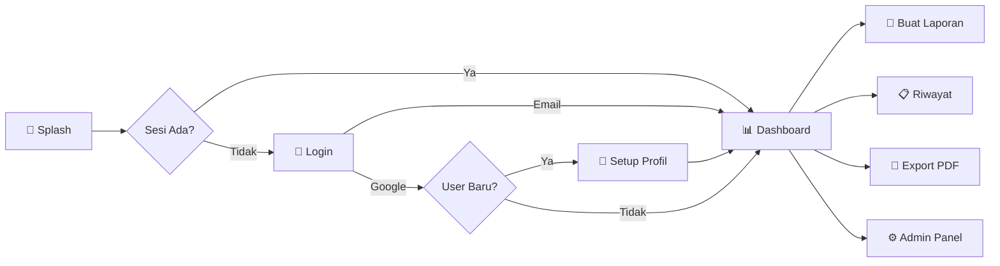

<div align="center">

# 🏥 Laporan Kunjungan Rumah

### Aplikasi Pencatatan Kunjungan Pasien untuk Kader & Petugas Puskesmas

<br>

[](https://flutter.dev/)
[](https://dart.dev/)
[](https://supabase.com/)
[](#-autentikasi)
[](#)

<br>


</div>

<br>

---

<br>

## ✨ Tentang Aplikasi

**Laporan Kunjungan Rumah** adalah aplikasi mobile berbasis Flutter yang dirancang khusus untuk **Kader Kesehatan** dan **Petugas Puskesmas** dalam mencatat, mengelola, dan melaporkan data kunjungan rumah pasien.

Dibangun dengan arsitektur **Offline-First**, aplikasi ini mampu bekerja tanpa internet dan secara otomatis menyinkronkan data ke cloud saat koneksi tersedia — sempurna untuk digunakan di lapangan.

<br>

## 🎯 Fitur Utama

<table>
<tr>
<td width="50%">

### 📋 Pencatatan & Manajemen
- 📝 **Formulir Pemeriksaan Lengkap** — Identitas pasien, keluhan, hasil pemeriksaan, dan tindak lanjut
- 🗂️ **Riwayat Laporan** — Pencarian, filter, dan pengelolaan semua laporan
- 🔍 **Pencarian Global** — Cari data lintas akun & puskesmas (admin)
- 📷 **Dokumentasi Foto** — Lampirkan foto pemeriksaan per pasien
- 🎤 **Speech-to-Text** — Input data melalui suara
- 💾 **Auto-Save Draft** — Formulir otomatis tersimpan agar tidak hilang

</td>
<td width="50%">

### ☁️ Cloud & Sinkronisasi
- 🌐 **Offline-First** — Bekerja tanpa internet, sync otomatis saat online
- 🔄 **Auto-Sync** — Sinkronisasi real-time ke Supabase Cloud
- 🗑️ **Auto-Delete Cerdas** — Hapus otomatis data lama berdasarkan pengaturan admin
- 📤 **Cloud Backup** — Data tersimpan aman di server
- 🟢 **Status Koneksi** — Banner real-time menunjukkan status online/offline

</td>
</tr>
<tr>
<td width="50%">

### 🔐 Keamanan & Autentikasi
- 🔑 **Login Email/Password** — Autentikasi aman via Supabase Auth
- 🔵 **Google Sign-In** — Login instan menggunakan akun Google
- 👤 **Profil Kader Wajib** — Setup nama & puskesmas sebelum mulai
- 🛡️ **Row-Level Security** — Data terlindungi di tingkat database
- 🔒 **Reset Password** — Via OTP ke email terdaftar

</td>
<td width="50%">

### 📊 Admin Panel & Ekspor
- 👥 **Kelola User** — Lihat, edit profil, ubah role, reset password
- 📈 **Dashboard Laporan** — Statistik penggunaan & penyimpanan
- 🖼️ **Kelola Foto** — Monitor storage & hapus file lama
- 📄 **Export PDF** — Laporan profesional siap cetak
- ⚙️ **Remote Config** — Atur auto-delete dari server

</td>
</tr>
</table>

<br>

## 🛠️ Tech Stack

<div align="center">

| Layer | Teknologi | Fungsi |
|:---:|:---|:---|
| 📱 | **Flutter 3.8** | Frontend framework |
| 🎯 | **Dart 3.8** | Programming language |
| ☁️ | **Supabase** | Backend, Auth, Database, Storage |
| 🔵 | **Google Sign-In** | OAuth 2.0 authentication |
| 💾 | **SharedPreferences** | Local data persistence |
| 📄 | **pdf** | PDF document generation |
| 🎨 | **Lottie** | Splash screen animation |
| 🎤 | **speech_to_text** | Voice input |

</div>

<br>

## 🏗️ Arsitektur

```
┌─────────────────────────────────────────────────┐
│                    Flutter App                   │
│  ┌───────────┐  ┌───────────┐  ┌──────────────┐ │
│  │  Screens  │  │  Widgets  │  │    Models    │ │
│  └─────┬─────┘  └─────┬─────┘  └──────┬───────┘ │
│        │              │               │          │
│  ┌─────┴──────────────┴───────────────┴───────┐  │
│  │              Services Layer                │  │
│  │  ┌──────────────┐  ┌────────────────────┐  │  │
│  │  │StorageService│  │  SupabaseService   │  │  │
│  │  │  (Offline)   │  │   (Cloud Sync)     │  │  │
│  │  └──────┬───────┘  └────────┬───────────┘  │  │
│  └─────────┼───────────────────┼──────────────┘  │
└────────────┼───────────────────┼─────────────────┘
             │                   │
     ┌───────┴───────┐  ┌───────┴────────┐
     │SharedPrefs    │  │   Supabase     │
     │(Local JSON)   │  │  ┌──────────┐  │
     └───────────────┘  │  │PostgreSQL│  │
                        │  │ Storage  │  │
                        │  │  Auth    │  │
                        │  └──────────┘  │
                        └────────────────┘
```

<br>

## 📂 Struktur Proyek

```
lib/
├── main.dart                      # Entry point + Supabase init
├── models/
│   ├── report.dart                # Model laporan kunjungan
│   ├── resident_exam.dart         # Model pemeriksaan pasien
│   └── user_session.dart          # Model sesi pengguna
├── screens/
│   ├── splash_screen.dart         # Splash dengan animasi Lottie
│   ├── login_screen.dart          # Login + Google Sign-In
│   ├── google_profile_setup_screen.dart  # Setup profil pertama kali
│   ├── dashboard_screen.dart      # Menu utama + auto-cleanup
│   ├── report_form_screen.dart    # Formulir laporan baru
│   ├── report_history_screen.dart # Riwayat + pencarian global
│   ├── admin_panel_screen.dart    # Admin: kelola user/laporan/foto
│   └── resident_exam_form_screen.dart   # Form pemeriksaan pasien
├── services/
│   ├── storage_service.dart       # Penyimpanan lokal (offline)
│   └── supabase_service.dart      # Cloud sync, auth, admin ops
├── widgets/
│   ├── connectivity_banner.dart   # Banner status online/offline
│   └── changelog_dialog.dart      # Dialog changelog versi baru
└── theme/
    └── app_theme.dart             # Design system & tema gelap
```

<br>

## 🚀 Memulai

### Prasyarat

- ✅ Flutter SDK `>=3.8.0`
- ✅ Android Studio / VS Code
- ✅ Perangkat Android atau Emulator (min SDK 21)

### Instalasi

```bash
# 1. Clone repository
git clone https://github.com/ESTAS-crypto/android-puskesmas.git

# 2. Masuk ke folder proyek
cd android-puskesmas

# 3. Install dependencies
flutter pub get

# 4. Jalankan aplikasi (mode debug)
flutter run

# 5. Build APK release (untuk distribusi)
flutter build apk --release --split-per-abi
```

### Konfigurasi Supabase

Aplikasi sudah terkonfigurasi dengan instance Supabase. Jika ingin menggunakan instance sendiri, ubah di `lib/main.dart`:

```dart
await Supabase.initialize(
  url: 'YOUR_SUPABASE_URL',
  anonKey: 'YOUR_SUPABASE_ANON_KEY',
);
```

### Konfigurasi Google Sign-In

1. Buat OAuth Client ID di [Google Cloud Console](https://console.cloud.google.com/apis/credentials)
2. Aktifkan Google Provider di **Supabase Dashboard → Authentication → Providers**
3. Masukkan Web Client ID di `lib/services/supabase_service.dart`

<br>

## 📱 Alur Penggunaan



<br>

## 🧹 Sistem Auto-Delete

Aplikasi memiliki mekanisme pembersihan otomatis berlapis:

| Layer | Trigger | Target | Konfigurasi |
|:---|:---|:---|:---|
| 🟢 **Lokal (HP)** | Saat buka Dashboard | File foto & laporan di HP | Admin Panel → Auto-Delete Lokal |
| 🔴 **Server (Cloud)** | Saat Admin buka app | Data & foto di Supabase | Admin Panel → Auto-Delete Server |

> Data yang sudah melewati batas waktu yang ditentukan admin akan otomatis dihapus di background tanpa mengganggu performa aplikasi.

<br>

## 🔐 Autentikasi

Aplikasi mendukung dua metode login:

| Metode | Keterangan |
|:---|:---|
| 📧 **Email + Password** | Register dengan OTP verification, login dengan username atau email |
| 🔵 **Google Sign-In** | One-tap login, setup nama kader wajib untuk user baru |

<br>

## 📦 Dependencies

| Package | Versi | Fungsi |
|:---|:---|:---|
| `supabase_flutter` | ^2.8.0 | Backend cloud |
| `google_sign_in` | ^6.2.1 | Autentikasi Google |
| `shared_preferences` | ^2.3.3 | Penyimpanan lokal |
| `speech_to_text` | ^7.0.0 | Input suara |
| `pdf` | ^3.11.1 | Generate PDF |
| `image_picker` | ^1.1.2 | Ambil foto |
| `lottie` | ^3.3.0 | Animasi splash |
| `share_plus` | ^10.1.4 | Bagikan file |
| `google_fonts` | ^6.2.1 | Tipografi premium |
| `pin_code_fields` | ^8.0.1 | Input OTP |
| `intl` | ^0.19.0 | Format tanggal |

<br>

## 🗄️ Database Schema (Supabase)

```sql
-- Tabel profil pengguna
CREATE TABLE profiles (
  id          UUID PRIMARY KEY REFERENCES auth.users(id),
  username    TEXT UNIQUE,
  email       TEXT,
  nama        TEXT,
  puskesmas   TEXT,
  role        TEXT DEFAULT 'user'
);

-- Tabel laporan kunjungan
CREATE TABLE reports (
  id          TEXT PRIMARY KEY,
  user_id     UUID REFERENCES auth.users(id),
  no          INTEGER,
  nama_petugas TEXT,
  puskesmas   TEXT,
  bulan       TEXT,
  tahun       TEXT,
  created_at  TIMESTAMPTZ DEFAULT now()
);

-- Tabel pemeriksaan pasien
CREATE TABLE resident_exams (
  id          TEXT PRIMARY KEY,
  report_id   TEXT REFERENCES reports(id) ON DELETE CASCADE,
  nama        TEXT,
  nik         TEXT,
  alamat      TEXT,
  umur        INTEGER,
  keluhan     TEXT,
  pemeriksaan TEXT,
  tindak_lanjut TEXT,
  foto_path   TEXT,
  created_at  TIMESTAMPTZ DEFAULT now()
);
```

<br>

## 👨‍💻 Dikembangkan Oleh

<div align="center">

| | |
|:---:|:---|
| 👤 | **ESTAS-crypto** |
| 🔗 | [github.com/ESTAS-crypto](https://github.com/ESTAS-crypto) |
| 📦 | [android-puskesmas](https://github.com/ESTAS-crypto/android-puskesmas) |

</div>

<br>

---

<div align="center">

**Laporan Kunjungan Rumah** — Dibuat dengan ❤️ untuk petugas kesehatan Indonesia

<br>


</div>
